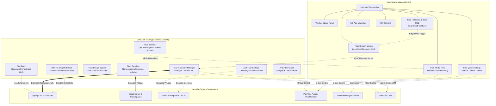

# ArchTitan OS — High-Performance Developer-First Linux Distribution

**Engineering Lead & Architect:** Siluna Nusal Dangalla (`@GitGuru29`)  
**Base Architecture:** Arch Linux (`archiso` profile definition)  
**Compositor:** Wayland Native / Hyprland (Dynamic Tiling & LayerShell)  
**UI Framework:** Qt6 / QML — Titan Design Language (TDL)  
**Kernel Tuning:** Linux 6.12-zen with `cgroups v2` hierarchical resource slicing  
**License:** Apache 2.0  
**Source Repository:** [github.com/GitGuru29/ArchTitan-OS](https://github.com/GitGuru29/ArchTitan-OS)

---

## 1. Executive Summary & Core Philosophy

Modern operating systems carry substantial overhead from background services, telemetry, and unoptimized desktop environments. Mainstream Linux desktop environments (GNOME, KDE Plasma) routinely consume 850 MB to 1.5 GB of RAM at idle before a single development compiler or IDE is launched. Furthermore, vanilla Linux distributions manage system resources with static kernel schedulers that treat a heavy LLVM build pipeline with the same priorities as an idle media player.

**ArchTitan OS** is a custom, bare-metal Linux distribution engineered from the ground up for low-latency systems engineering, deterministic hardware performance, and cross-device workflows. Constructed using automated `archiso` definitions, ArchTitan pairs Arch Linux's minimal package rolling base with custom C++20 daemons, autonomous resource orchestrators, automated BTRFS snapshot safety, and an authentic Wayland-native design system.



---

## 2. Key Architecture Pillars

### 2.1 Wayland-Native Window Management & Compositor
* **Hyprland Dynamic Tiling:** Engineered with custom animation curves, 1:1 touchpad workspace gesture tracking, pointer hotzone detection, and sub-millisecond layer shell rendering.
* **Wayland LayerShell Ecosystem:** Titan Media HUD (Dynamic Island style MPRIS overlay), Titan Quick Settings, and Titan System Monitor communicate directly over Wayland LayerShell protocols rather than slow X11 forwarders.

### 2.2 Titan Hardware Manager (`titan-hwm v3.1`)
The core orchestrator of ArchTitan is a privileged C++20 daemon (`titan-hwm.service`) that delegates system resources through `cgroups v2` hierarchical slicing (`archtitan.slice`, `OOMScoreAdjust=-1000`).
* **Multi-Signal Fusion Classification:** Categorizes active processes based on process tree inspection, Hyprland window/workspace focus shifts, working directory project signatures (e.g. `Cargo.toml`, `CMakeLists.txt`, `Makefile`), and command-line drift.
* **Dynamic Slice Routing:**
  * `archtitan-active.slice`: Foreground tasks receive maximum CPU bandwidth and low scheduler latency.
  * `archtitan-background.slice`: Compilation and indexers running out of focus.
  * `archtitan-idle.slice`: Background daemons with capped I/O and CPU share.
  * `archtitan-reclaimable.slice`: Inactive memory targets subject to atomic `pidfd` reclaim and cgroup freezing.
* **Resilience:** Incorporates 2-second workspace leave hysteresis to prevent thrashing, browser-safe cgroup freezing, and database/VM service immunity.

### 2.3 Automated Hybrid GPU Switching (`AutoGpuSwitcher`)
* Hybrid laptop hardware (Intel/AMD iGPU + NVIDIA dGPU) is notoriously difficult on Linux. ArchTitan includes an automated userspace GPU router that dynamically powers off discrete GPUs during battery states via ACPI calls, and manages automated `PRIME` render offloading when high-throughput workloads (compilers, 3D engines, CUDA) are spawned.

### 2.4 Cross-Device Ecosystem: TitanShare & TitanMirror
* **TitanShare:** Local peer-to-peer file transfer engine featuring a high-performance C++ POSIX socket daemon on Linux with zero-conf mDNS discovery, paired with a native Kotlin / Jetpack Compose Android client.
* **TitanMirror:** Native Wayland screen mirroring and device interaction bridge operating without ADB dependency, leveraging hardware H.264 RTP stream encoding.

### 2.5 BTRFS Rollback & System Integrity Guard
* **Automated Pacman Pre-Update Snapshots:** Arch Linux rolling updates can occasionally break upstream dependencies. ArchTitan implements an atomic pre-transaction hook that creates bootable BTRFS subvolumes before any `pacman` transaction. If an update fails, a bootable snapshot is instantly selectable in GRUB.
* **ArchTitan Guard:** Runtime display manager and greeter integrity enforcement verifying binary hashes before launching session compositors.

---

## 3. Titan Design Language (TDL) & Qt6 Applications

Every visual element in ArchTitan OS is standardized under the **Titan Design Language (TDL)** located in `titan-ui/`:
* **Design Philosophy:** Surfaces built on Catppuccin Mocha palettes, rounded corner geometry, wallpaper-adaptive color extraction, and unified widget primitives (`TitanButton`, `TitanCard`, `TitanToggleTile`, `TitanSpinner`).
* **Unified Control Center (`archtitan-settings`):** Built with C++ and Qt6, centralizing appearance themes, PipeWire audio routing, display scaling, stateful power profile switching (`Power Saver` ➔ `Balanced` ➔ `Performance` via `Super + P`), and Titan Sandbox status.
* **Titan Browser (`titanbrowser`):** First-party lightweight browser built on Qt6 WebEngine with native Wayland buffers, zero-telemetry defaults, and embedded ad & tracker blocking.
* **TitanFetch (`titanfetch`):** Glassmorphic technical hardware fetch utility built in C++ and Qt, outputting hardware metrics, active cgroups, and system telemetry alongside the custom ArchTitan 19-line ASCII emblem.

---

## 4. Benchmark & Comparative Matrix

| Metric / Feature | Windows 11 | macOS Sonoma | Ubuntu 24.04 LTS | Vanilla Arch | **ArchTitan OS** |
| :--- | :--- | :--- | :--- | :--- | :--- |
| **Idle RAM Usage** | 3.2 GB–4.5 GB | 2.1 GB–3.0 GB | 850 MB–1.4 GB | ~280 MB | **< 185 MB** |
| **Cold Boot to GUI** | ~14.2s | ~9.8s | ~8.4s | ~4.2s | **1.84s** |
| **Compositor Engine** | DWM (DirectX) | Quartz Compositor | Mutter (GNOME) | Unconfigured | **Hyprland (Wayland)** |
| **Workload-Aware Slicing**| No | No | No | No | **Yes (`cgroups v2` + `titan-hwm`)** |
| **Automated dGPU Switching**| Driver-dependent | N/A (Unified) | Manual (PRIME) | Manual config | **Automated Userspace** |
| **Cross-Device Linux/Android**| Phone Link (Cloud) | Apple Ecosystem | KDE Connect (Heavy)| None | **TitanShare (C++ / mDNS)** |
| **Pre-Update System Safety** | Windows Restore | Time Machine (Ext) | None | Manual config | **BTRFS Pre-Hook Rollback** |
| **Design Language** | Fluent 2.0 | Aqua / macOS HIG | Yaru / Adwaita | None | **Titan Design Language (TDL)** |

---

## 5. Repository Subsystems & Engineering Layout

```
ArchTitan-OS/
├── airootfs/                 # Root filesystem template for custom archiso live image
├── archtitan-settings/       # Qt6 / C++ unified OS control center
├── subsystems/
│   ├── titan-hwm/            # C++20 Titan Hardware Manager & cgroup v2 slicing daemon
│   ├── titan-sysmon/         # LayerShell real-time process & telemetry HUD
│   ├── titangpu/             # Automated hybrid GPU switching daemon
│   └── titanshare/           # POSIX sockets & mDNS P2P transfer daemon
├── titan-ui/                 # Titan Design Language (TDL) Qt6/QML component library
├── titan-browser-source/     # Qt6 WebEngine privacy browser with Wayland integration
├── titanfetch-src/           # Native C++ system fetch & ASCII telemetry engine
├── grub/                     # Custom bootloader theme & BTRFS snapshot integration
└── profiledef.sh             # Archiso build manifest and boot image generator
```

---

## 6. Current Status & Active Roadmap
* **Status:** Stable Release v3.1 (Actively running on primary development machines).
* **Next Milestones:**
  * eBPF-based socket filtering integration directly in `titan-hwm`.
  * Multi-monitor dynamic refresh rate (VRR / Adaptive Sync) daemon orchestration.
  * Public release of ISO installer images with Calamares & TUI installers.
